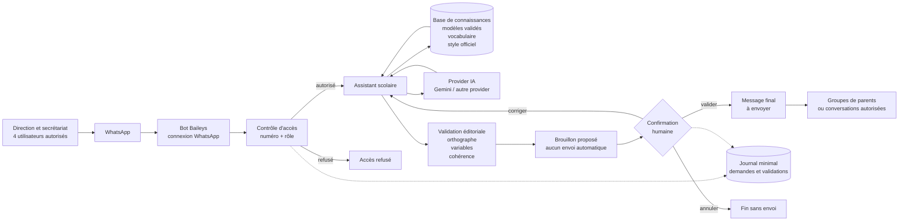
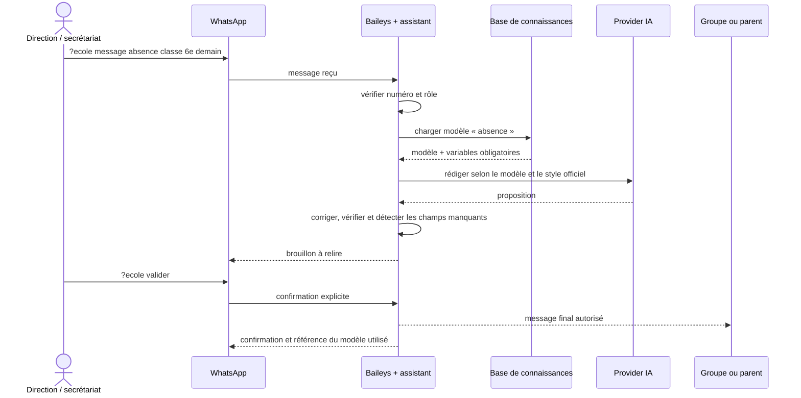

# Diagramme d'architecture

## Vue générale

## Flux d'une demande

## Règle de sécurité principale

L'IA prépare un texte, mais ne décide pas seule de l'envoi. Une personne
autorisée doit confirmer le brouillon. Si une date, une classe, un montant ou
une autre information obligatoire manque, le bot demande la précision au lieu
de l'inventer.
